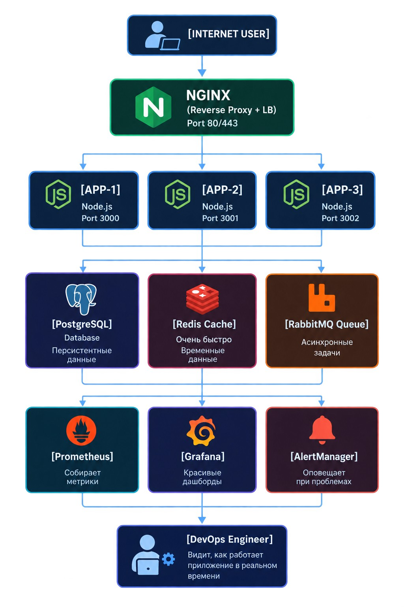

# DevOps-local-stack
Production-ready Docker Compose stack with monitoring

<!-- TOC -->
* [DevOps-local-stack](#devops-local-stack)
  * [Структура репозитория:](#структура-репозитория)
  * [Цель](#цель)
  * [Технологическое решение](#технологическое-решение)
    * [Схема проекта](#схема-проекта)
    * [Аркестрация](#аркестрация)
    * [База данных (БД)](#база-данных-бд)
    * [Кэш](#кэш)
    * [Брокер сообщений](#брокер-сообщений)
    * [Reverse proxy](#reverse-proxy-)
    * [Мониторинг](#мониторинг)
  * [Диагностика и восстановление](#диагностика-и-восстановление)
    * [Выход из строя одной ноды node.js](#выход-из-строя-одной-ноды-nodejs)
    * [Выход из строя Redis](#выход-из-строя-redis)
    * [Переполнение RabbitMQ](#переполнение-rabbitmq)
    * [Падение PostgreSQL](#падение-postgresql)
<!-- TOC -->

## Структура репозитория:

```
devops-local-stack/
├── app/
│   └── src/
├── nginx/
├── monitoring/
│   ├── prometheus/
│   ├── grafana/
│   │   └── dashboards/
│   └── alertmanager/
├── scripts/
├── docs/
├── tests/
├── .git/
├── .gitignore
├── LICENSE
└── README.md
```
## Цель

- Локальное production-like окружение
- Бесплатно
- Быстрое развертывание

## Технологическое решение

### Схема проекта



### Аркестрация

Механизмом аркестрации был выбран Docker Compose из-за следующих факторов:

- Легковесность
- Простота чтения конфигурации
- Простота в использовании
- Бесплатный

### База данных (БД)

При выборе БД, оптимальным выбором оказалась PostgreSQL:

- Зачастую используется в production среде
- JSON поддержка
- Бесплатная

### Кэш

Механизмом кэширования был выбран Redis :

- Поддерживает разные типы данных
- Большое количество фич
- Чаще всего встречается в production среде
- Встроенная персистентность
- Бесплатный

### Брокер сообщений

В роли брокера сообщений выбран RabbitMQ:

- Надежность
- Простота использования
- Хорошая документация
- Чаще всего встречается в production среде
- Бесплатный
- Легковесная для локальной среды

### Reverse proxy 

Оптимальный вариантом является Nginx:

- Чаще всего встречается в production среде
- Легкость конфигурации
- Встроенный балансировщик нагрузки
- Встроенный Rate limiting

### Мониторинг

Наиболее оптимальным решением является Prometheus + Grafana:

- Чаще всего встречается в production среде
- Бесплатный
- Работает локально без нагрузки на машину
- Встроенный alerting
- Простая архитектура
- Pull модель

## Как запустить

## Мониторинг

## Диагностика и восстановление

Перечень возможных проблем и их решение

### Выход из строя одной ноды node.js
### Выход из строя Redis
### Переполнение RabbitMQ
### Падение PostgreSQL